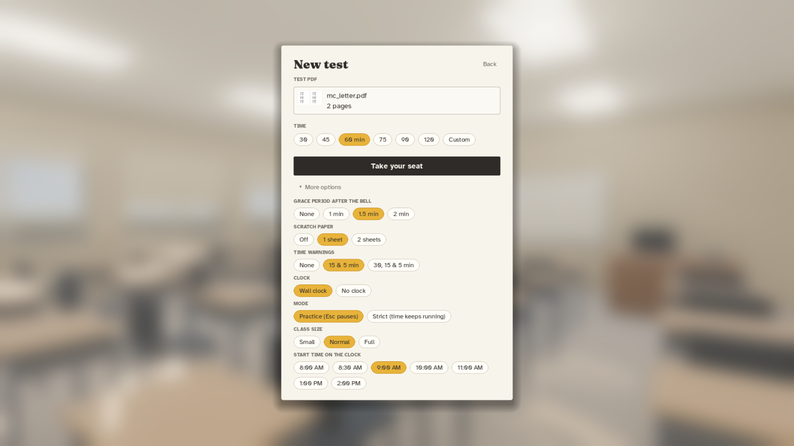
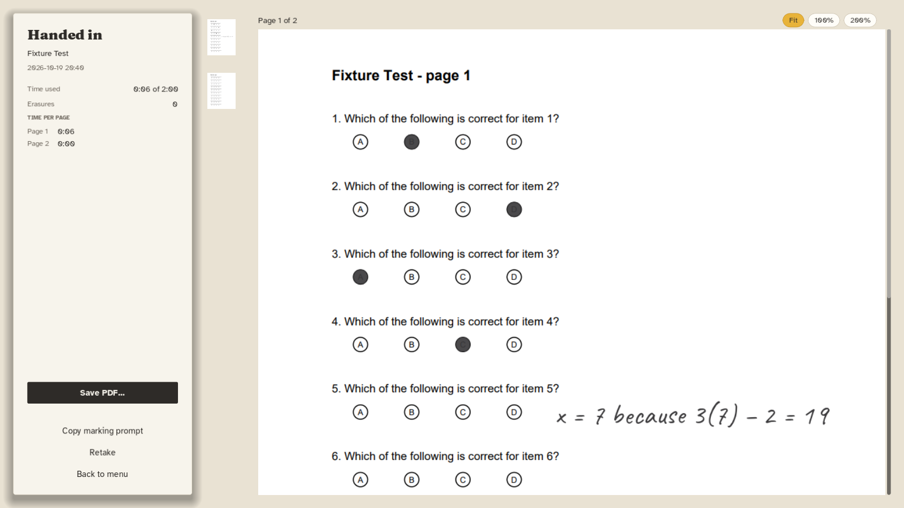
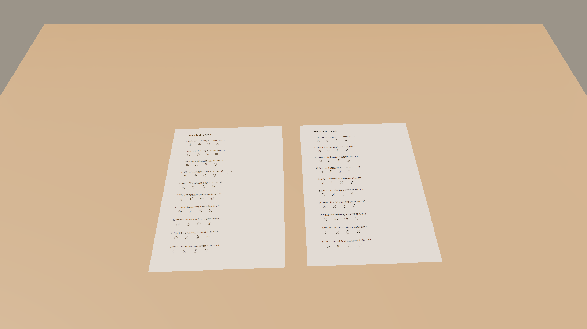

# Pencils Down

**A realistic, first-person test-taking simulator.** Load a past or sample test as a PDF, sit at a desk in a quiet morning classroom, and take it under real exam conditions: the bell, the wall clock, the teacher's time warnings, the end-of-test grace period. When time is up, hand it in and save a PDF with your answers to keep, or to give to an AI (or a person) to mark.

Timed practice at home doesn't feel like an exam room. Pencils Down tries to, so the real exam feels familiar.

| | |
|---|---|
|  |  |
|  |  |

> **Status: v0.1 in progress.** This build has the full test loop: PDF in, pencil, typed handwriting, Quick Fill bubbles, clock, bells, grace period, hand-in, review and PDF out. It runs in a *blocked-out* classroom. Still to come: the modelled morning classroom with baked lighting (Plan 2), students, the teacher and your hand (Plan 3), ambient sound and polish (Plan 4), then the AI teacher and more classrooms. See the [design document](docs/superpowers/specs/2026-10-19-pencils-down-design.md).

## Download

Prebuilt versions for Windows, macOS and Linux are on the [Releases](../../releases) page.

- **Windows:** unzip and run `PencilsDown.exe`.
- **macOS:** unzip, then right-click `Pencils Down.app` → **Open** the first time (the app isn't signed yet, so a double-click is blocked by Gatekeeper).
- **Linux:** extract and run `PencilsDown.x86_64`.

## How to take a test

1. **New test** → drop a PDF on the window (or click the box to choose one).
2. Pick the time (30–120 minutes or custom). **More options** has the grace period, scratch paper, time warnings, Practice/Strict mode and more. Everything is remembered for next time.
3. **Take your seat.** The teacher hands out the tests and writes the start and end times on the board. The bell rings, and you begin.
4. When the end bell rings you have a grace period (1.5 minutes by default). Press **H** to hand in, or the teacher collects it when time's up.
5. On the review screen, **Save PDF…** and **Copy marking prompt**. Paste the prompt into an AI with the saved PDF and your answer key, and it marks the test question by question.

Use tests you have the right to use (your own school's past papers, official released exams and sample tests). Tests never leave your computer.

## Controls

| Action | Key |
|---|---|
| Write / erase (the pencil flips to its eraser) | Left-drag / Right-drag |
| Fill a bubble / clear it | Shift + click / Shift + right-click |
| Type an answer in handwriting | **T** or double-click where it should go |
| Finish typing | Esc or click elsewhere |
| Typed text smaller / bigger | Ctrl + [ / Ctrl + ] |
| Turn page | A / D |
| See all pages | hold Q |
| Scratch paper ↔ test | Tab |
| Slide the paper / lean in | Mouse wheel / Ctrl + wheel |
| Look up at the room and clock | hold Space, or rest the cursor at the top of the screen |
| Undo / redo | Ctrl + Z / Ctrl + Y |
| Hand in (after the end bell) | H |
| Menu (pauses in Practice mode) | Esc |

If the game closes unexpectedly, your test is autosaved every 20 seconds. Choose **Resume test in progress** on the main menu.

## The exported PDF

The original test stays untouched underneath. Your pencil work is added as vector lines, and typed answers appear in your handwriting plus an invisible text layer, so an AI marker reads them exactly. Scratch paper with marks on it is added at the end.

## Build from source

1. Install [Godot 4.7.2](https://godotengine.org/download) (standard build, not .NET).
2. Fetch the PDF extension (not committed because of its size): `bash tools/fetch_pdfium_gde.sh`
3. Open `project.godot` in Godot and press Play.

Tests use [GUT](https://github.com/bitwes/Gut): `bash tools/run_tests.sh`. Test PDFs are generated by `python tools/make_fixtures.py`.

Tagging a commit `v*` runs `.github/workflows/release.yml`, which builds all three platforms and publishes a GitHub Release.

## Credits and license

Code is MIT ([LICENSE](LICENSE)). Fonts, libraries and other assets are listed in [CREDITS.md](CREDITS.md); only CC0, CC-BY and SIL OFL material is included.
