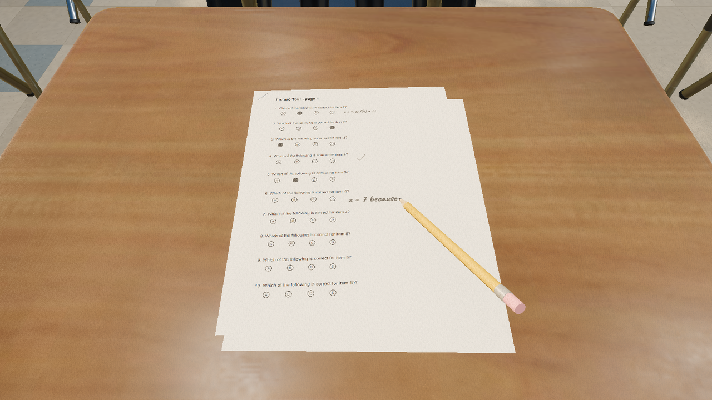
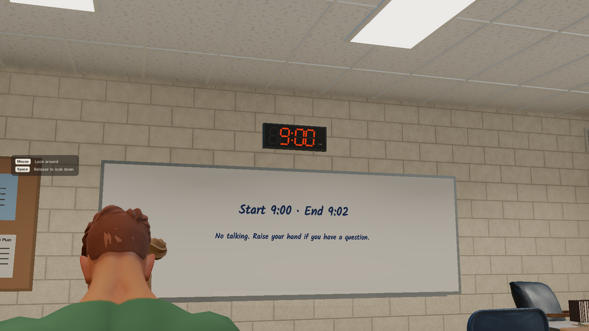
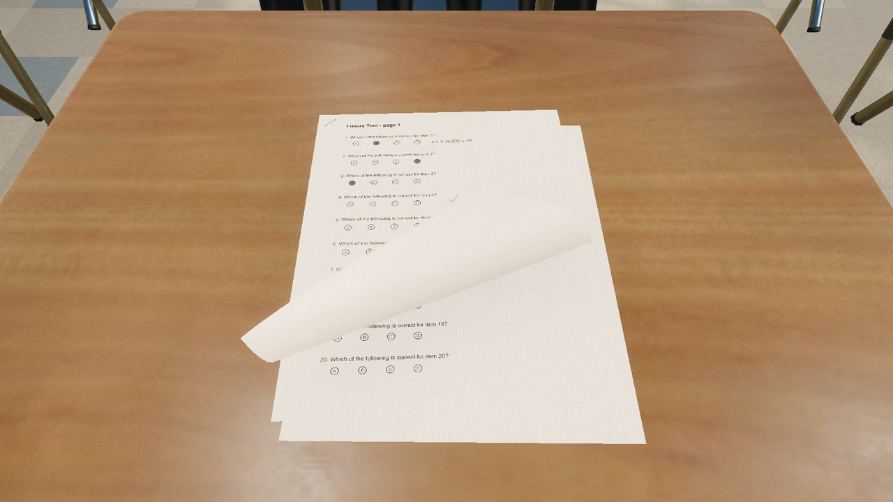
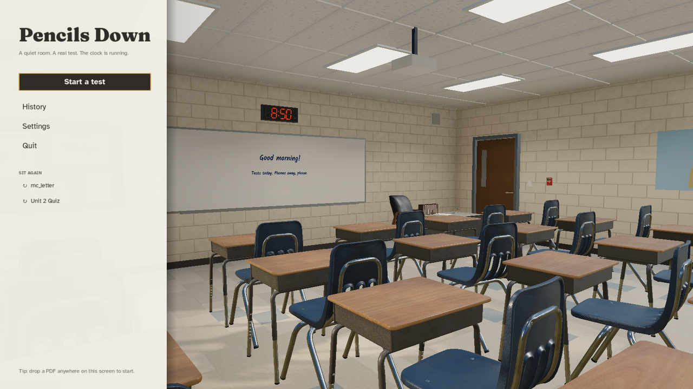
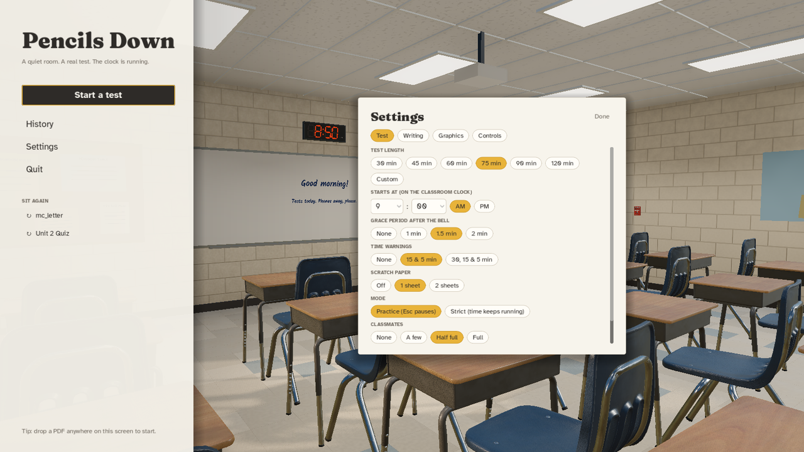

# Pencils Down

**A realistic, first-person test-taking simulator.** Load a past or sample test as a PDF, sit at a desk in a quiet morning classroom, and take it under real exam conditions: the bell, the wall clock, the teacher's time warnings, the end-of-test grace period. When time is up, hand it in and save a PDF with your answers to keep, or to give to an AI (or a person) to mark.

Timed practice at home doesn't feel like an exam room. Pencils Down tries to, so the real exam feels familiar.

| | |
|---|---|
|  |  |
|  |  |

> **Status: v0.2 in progress.** The full test loop works (PDF in, pencil, typed handwriting, Quick Fill bubbles, clock, bells, grace period, hand-in, review and PDF out) in a furnished morning classroom with seated classmates, a digital wall clock and a stapled packet whose pages you turn by hand. Still to come: the teacher and your hand, ambient sound, then the AI teacher and more classrooms. See the [design document](docs/superpowers/specs/2026-10-19-pencils-down-design.md).

## Download

Prebuilt versions for Windows, macOS and Linux are on the [Releases](../../releases) page.

- **Windows:** unzip and run `PencilsDown.exe`.
- **macOS:** unzip, then right-click `Pencils Down.app` → **Open** the first time (the app isn't signed yet, so a double-click is blocked by Gatekeeper).
- **Linux:** extract and run `PencilsDown.x86_64`.

## How to take a test

1. **Start a test** → drop a PDF on the window (or click the box to choose one). You can also drop a PDF anywhere on the main menu, or click a recent test under **Sit again**.
2. The card shows the test length and the time on the classroom clock when it starts (for example "60 min · starts 9:00 AM"). **Change** opens the full setup: length (30–120 minutes or custom), start time, grace period, scratch paper, time warnings, Practice/Strict mode, classmates and the clock. The same options are under **Settings → Test**, and everything is remembered for next time.
3. **Take your seat.** The camera walks you to your desk, the start and end times go up on the board, the bell rings and you begin.
4. When the end bell rings you have a grace period (1.5 minutes by default). Press **H** to hand in, or the teacher collects it when time's up.
5. On the review screen, **Save PDF…** and **Copy marking prompt**. Paste the prompt into an AI with the saved PDF and your answer key, and it marks the test question by question.

Use tests you have the right to use (your own school's past papers, official released exams and sample tests). Tests never leave your computer.

## Controls

The keys for what you can do right now are listed down the left of the screen. The list fades when you're busy and comes back when you press anything; **F1** hides or shows it (Settings → Controls chooses Always / Fade when idle / Hidden). The first test also shows three short tips.

| Action | Key |
|---|---|
| Write / erase (the pencil flips to its eraser) | Left-drag / Right-drag |
| Fill a bubble / clear it | Shift + click / Shift + right-click |
| Type an answer in handwriting | **T** or double-click where it should go |
| Finish typing | Esc or click elsewhere |
| Typed text smaller / bigger | Ctrl + [ / Ctrl + ] |
| Turn the page | Grab the bottom or right edge (the cursor becomes a hand) and pull it up over the staple; let go to finish or drop it back. Pull the turned page back down to go back. Or A / D |
| See all pages | hold Q |
| Scratch paper ↔ test | Tab |
| Lean in toward the cursor / sit back | Mouse wheel |
| Slide the paper up / down | W / S, or Ctrl + wheel |
| Look up at the clock and board | hold Space, or rest the cursor at the top of the screen |
| Undo / redo | Ctrl + Z / Ctrl + Y |
| Hand in (after the end bell) | H |
| Menu (pauses in Practice mode) | Esc |
| Show / hide the keys | F1 |

If the game closes unexpectedly, your test is autosaved every 20 seconds. Choose **Resume your test** on the main menu.

## The exported PDF

The original test stays untouched underneath. Your pencil work is added as vector lines, and typed answers appear in your handwriting plus an invisible text layer, so an AI marker reads them exactly. Scratch paper with marks on it is added at the end.

## Build from source

1. Install [Godot 4.7.2](https://godotengine.org/download) (standard build, not .NET).
2. Fetch the PDF extension and the CC0 classroom art (not committed because of their size): `bash tools/fetch_pdfium_gde.sh` and `python tools/fetch_assets.py` (downloads about 45 MB from Poly Haven and checks each file against `tools/asset_manifest.json`).
3. Open `project.godot` in Godot and press Play.

Tests use [GUT](https://github.com/bitwes/Gut): `bash tools/run_tests.sh`. Test PDFs are generated by `python tools/make_fixtures.py`.

Tagging a commit `v*` runs `.github/workflows/release.yml`, which builds all three platforms and publishes a GitHub Release.

## Credits and license

Code is MIT ([LICENSE](LICENSE)). Fonts, libraries and other assets are listed in [CREDITS.md](CREDITS.md); only CC0, CC-BY and SIL OFL material is included.
